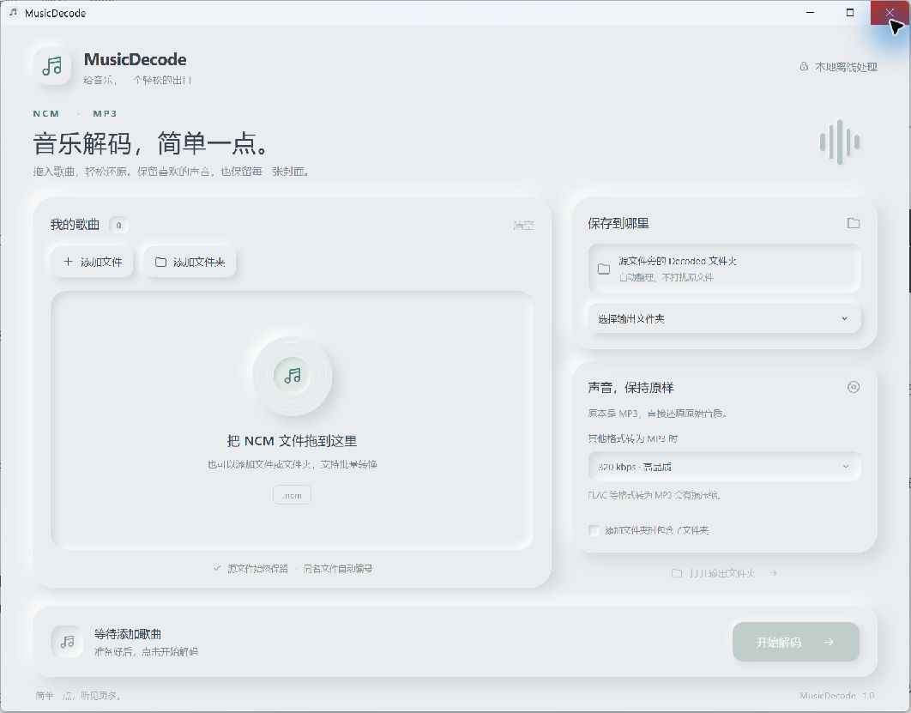

# MusicDecode

**简约新拟态风格的本地 NCM → MP3 桌面工具。**

[English](README.md) | 简体中文

[](https://github.com/koabula/MusicDecode/actions/workflows/ci.yml)
[](https://github.com/koabula/MusicDecode/actions/workflows/release.yml)
[](https://github.com/koabula/MusicDecode/releases/latest)
[](LICENSE)

拖入 NCM 文件，选择保存位置，一键开始解码。所有音频处理都在本机进行。软件界面目前为简体中文，文档提供中英文版本。



## 下载

前往 **[GitHub Releases](https://github.com/koabula/MusicDecode/releases/latest)** 下载。

| 系统 | 架构 | 下载文件 |
| --- | --- | --- |
| Windows 10 / 11 | x64 | `*-setup.exe` |
| macOS 12 及以上 | Apple Silicon / ARM64 | `.dmg` |
| Linux，以 Ubuntu 22.04 为构建基线 | x64 | `.AppImage` 或 `.deb` |

本次不提供 Intel Mac、Windows ARM64 或 Linux ARM64 版本。运行安装后的软件不需要安装 Node.js、Rust、.NET 或额外的 FFmpeg。

### 安装

- **Windows：**运行安装程序，可选择中文或英文安装界面，默认安装到当前用户。程序需要 WebView2，缺失时安装程序可安装该组件。安装包未做代码签名，Windows 可能显示信誉提示。
- **macOS：**打开 DMG，将 MusicDecode 拖入“应用程序”。本版本采用临时签名，未经过 Apple 公证，Gatekeeper 可能要求在“系统设置 → 隐私与安全性”中批准打开。详见 [Tauri 签名说明](https://v2.tauri.app/distribute/sign/macos/)。
- **Linux AppImage：**运行 `chmod +x MusicDecode*.AppImage` 赋予执行权限，然后启动。兼容性取决于发行版，可能需要 FUSE 或解压运行模式。
- **Debian / Ubuntu：**使用 `sudo apt install ./MusicDecode*.deb` 安装，依赖包含 GTK 3、WebKitGTK 4.1 和 `xdg-utils`。

下载后可使用对应的 `SHA256SUMS-*.txt` 验证文件完整性。校验和不等于代码签名证书。

## 功能

- 选择文件、添加文件夹和原生拖拽导入。
- 批量队列、单曲进度、取消任务及失败重试。
- 内部为 MP3 时直接提取，不重新编码。
- FLAC、M4A、WAV、Ogg 音频可转为 192 / 256 / 320 kbps MP3。
- 保留内嵌歌名、歌手、专辑及 JPEG / PNG 封面。
- 源文件始终保留，同名输出自动编号，不覆盖已有文件。
- 正式保存每首歌曲前，对整段音频做解码检查。
- 界面随窗口高度调整，仅歌曲列表滚动，底部操作始终可见。
- 不需要账号，不上传歌曲，不下载远程封面，无遥测。

## 使用方法

1. 点击“添加文件”“添加文件夹”，或将 NCM 文件、文件夹拖入窗口。
2. 如需集中保存，点击“选择输出文件夹”。默认在每个源文件目录下创建 `Decoded` 子文件夹。
3. 点击“开始解码”，完成后点击“打开输出文件夹”。

勾选“包含子文件夹”后，添加文件夹才会递归扫描；扫描会略过符号链接。每次导入最多 5,000 个文件。默认输出分散在多个源目录时，“打开输出文件夹”会打开最近一个成功文件的位置。

取消任务会清理当前未完成的临时文件，已经完成的文件会保留。某首歌曲失败不会中断其他歌曲。

### 音质说明

| NCM 内部的真实音频格式 | 处理方式 |
| --- | --- |
| MP3 | 保留原始音频数据和码率，转码音质设置不生效。 |
| 其他支持格式 | 解密后按所选码率编码为 MP3，属于有损转换。 |

程序根据解密后的音频文件头识别格式，NCM 元数据中的格式字段可能不准确。修改扩展名无法解密文件。没有内嵌封面时不会联网补全，提高码率也不能恢复源音频中不存在的细节。

## 开发环境

技术栈：**Tauri 2 + HTML/CSS/TypeScript + Rust**。FFmpeg 是独立运行、随应用打包的音频组件。

需要 Node.js 24、Rust stable，以及对应系统的 [Tauri 开发依赖](https://v2.tauri.app/start/prerequisites/)。编译音频组件还需要 C 编译器、Make、`pkg-config` 和 POSIX Shell。Windows 使用 MSYS2 MINGW64 编译音频组件，使用 MSVC 工具链编译 Rust 程序；macOS 使用 Xcode Command Line Tools。

```sh
npm ci
npm run audio:sources
bash scripts/build-ffmpeg.sh
cargo fetch --locked --manifest-path src-tauri/Cargo.toml
node scripts/notices.mjs
npm run desktop
```

请在与目标系统、架构匹配的构建 Shell 中执行音频编译。可显式设置 `MUSICDECODE_TARGET` 为 `x86_64-pc-windows-msvc`、`aarch64-apple-darwin` 或 `x86_64-unknown-linux-gnu`；未设置时通过 Rust 检测。本脚本不支持音频组件的跨架构交叉编译。

下载脚本按照 [`third-party/sources.json`](third-party/sources.json) 校验源码 SHA-256。音频组件使用 FFmpeg 9.0.2 和 LAME 3.100，禁用网络、GPL 及 nonfree 组件，只编译需要的音频功能。内嵌 JPEG / PNG 封面由 Rust 元数据层保留。

### 检查、测试和打包

```sh
npm run build
npm run check:version
cargo fmt --manifest-path src-tauri/Cargo.toml -- --check
cargo test --locked --manifest-path src-tauri/Cargo.toml
npm run package
```

测试前需要准备好音频组件。自动测试自行生成短音频，覆盖 MP3 数据保持、FLAC 转码、文件名、取消、损坏文件和同名输出。额外的真实文件回归测试可通过 `MUSICDECODE_TEST_NCM` 和 `MUSICDECODE_TEST_FFMPEG` 启用，CI 不依赖个人歌曲。

原生安装包位于 `src-tauri/target/release/bundle`；显式指定目标时位于 `src-tauri/target/<target>/release/bundle`。Windows 开发者还可运行 `npm run package:portable`，在 `release` 目录生成便携文件。

## GitHub Actions 发布

[`release.yml`](.github/workflows/release.yml) 使用对应系统的 GitHub Runner，分别构建 Windows x64、macOS ARM64、Linux x64。每个任务从固定源码编译音频组件，运行转换测试，再生成安装包和校验文件。macOS 任务还会检查临时签名。

三个系统全部成功后，发布任务校验所有文件，创建草稿、上传全部附件，最后公开发布。每次发布都提供 FFmpeg / LAME 的完整对应源码和构建脚本。

发布新版本时，同步修改 `package.json`、`package-lock.json`、`src-tauri/Cargo.toml`、`src-tauri/Cargo.lock` 和 `src-tauri/tauri.conf.json`，新增 `docs/releases/vX.Y.Z.md`，再推送对应的 `vX.Y.Z` 标签，或手动运行 Release 工作流。已公开的版本不会被覆盖。发布使用工作流自带的 `GITHUB_TOKEN`，不需要额外个人访问令牌。

## 常见问题

- **无法识别文件：**可能是文件不完整、内容并非 NCM，或使用尚未支持的加密变体。请保留原文件，查看歌曲列表中的错误原因。
- **找不到音频组件：**请重新安装完整程序。使用便携版时，保持 `musicdecode-ffmpeg.exe` 与 `MusicDecode.exe` 位于同一目录。
- **输出目录不可写：**选择有写入权限的文件夹后重试。
- **没有封面：**仅保留文件原有的 JPEG / PNG 封面。
- **Linux 无法启动：**检查发行版的 WebKitGTK / GTK 依赖及 AppImage 运行条件；构建通过不代表支持所有 Linux 发行版。

## 许可证与致谢

MusicDecode 应用代码使用 [MIT 许可证](LICENSE)。独立音频组件 FFmpeg / LAME 使用各自的 LGPL 许可证。安装包的 `licenses/audio` 中附有音频许可证和构建信息，其他依赖见 [`THIRD-PARTY-NOTICES.txt`](THIRD-PARTY-NOTICES.txt)。每个 Release 均提供对应音频源码与构建脚本。

感谢 [Tauri](https://tauri.app/)、[RustCrypto](https://github.com/RustCrypto)、[rust-id3](https://github.com/polyfloyd/rust-id3)、[FFmpeg](https://ffmpeg.org/) 和 [LAME](https://lame.sourceforge.io/)，以及整理 NCM 格式的 [ncmdump 社区](https://github.com/taurusxin/ncmdump)。

欢迎提交问题和有明确范围的 Pull Request。问题反馈请注明系统、软件版本、复现步骤和界面错误；请勿在公开问题中附上受版权保护的歌曲或个人文件。
